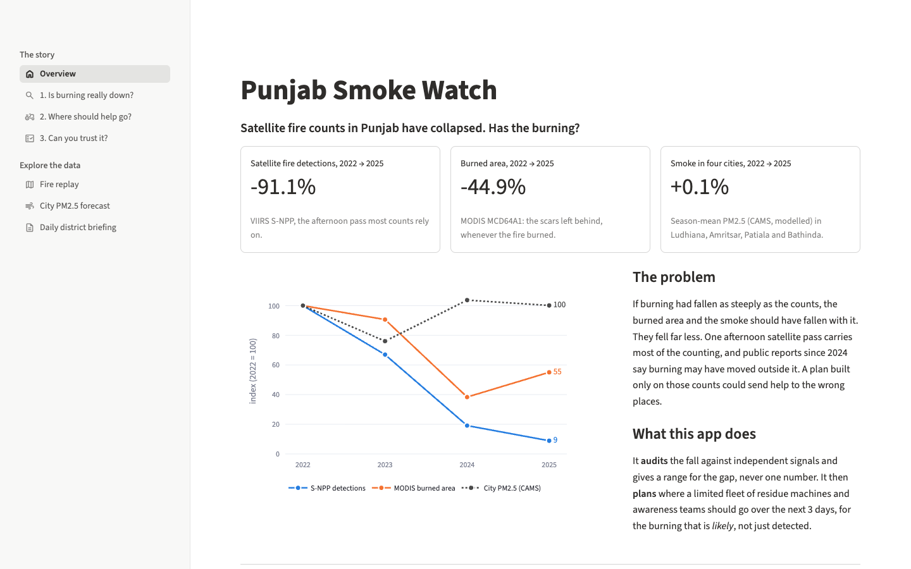
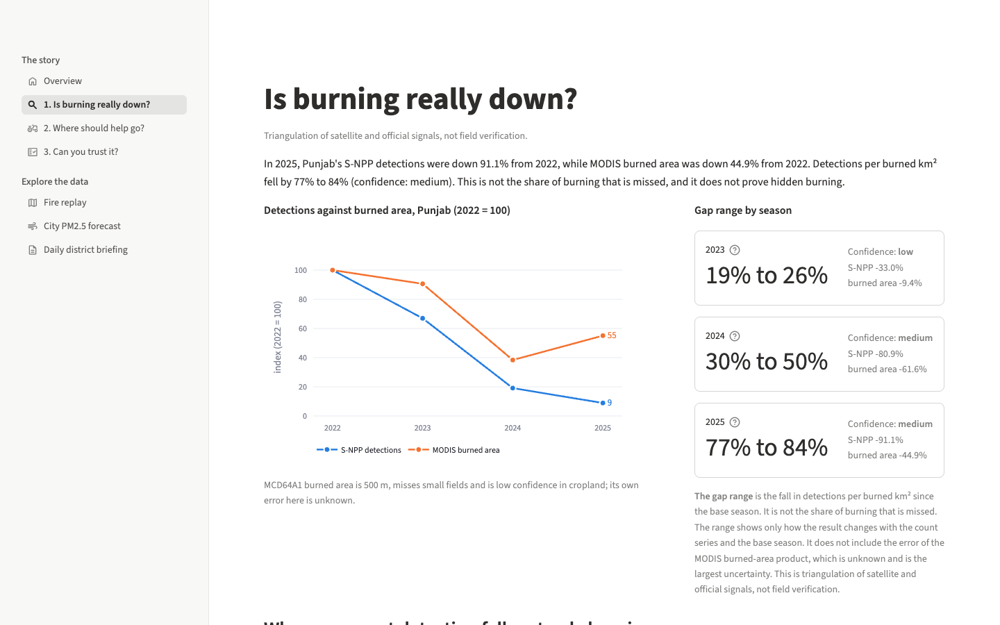
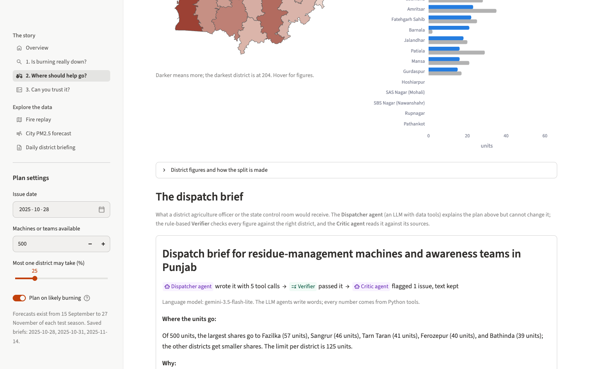
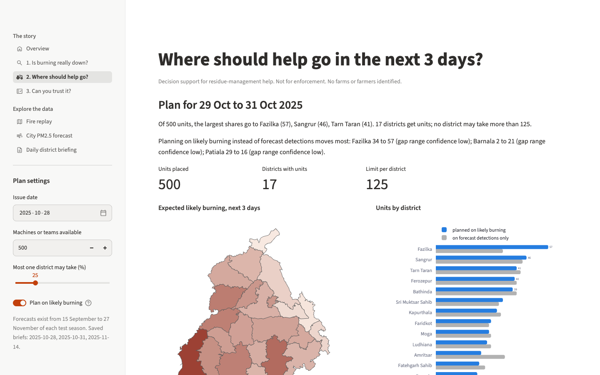
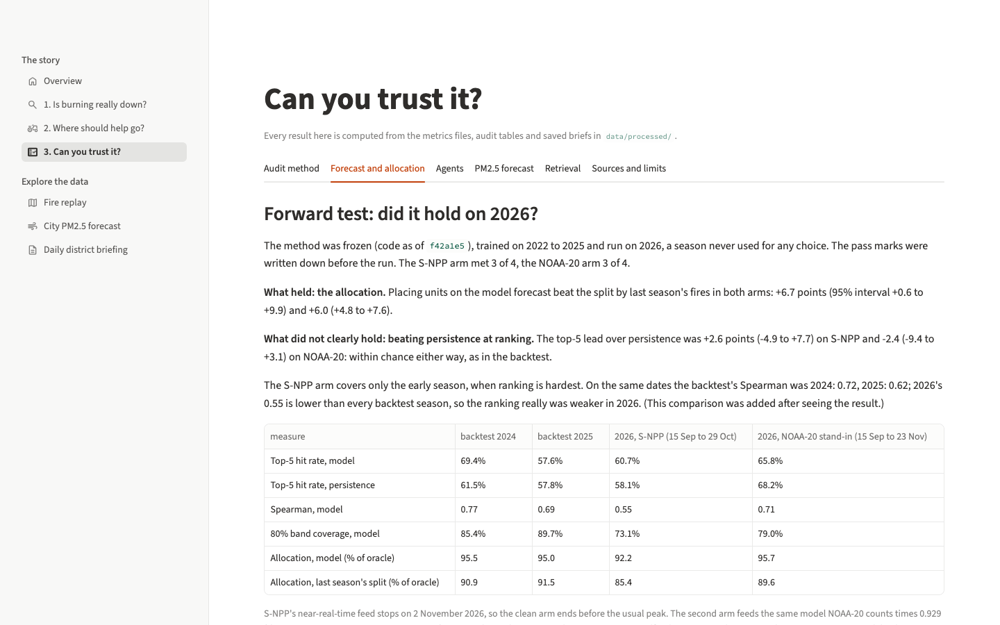

# Punjab Smoke Watch

Satellite fire counts in Punjab fell **91%** between 2022 and 2025. Did the burning really fall that much, and where should help go next?

Punjab Smoke Watch is an **agentic, RAG-grounded intelligence pipeline** that answers those two questions:
- **Audit:** it checks the fall against independent signals.
- **Response:** it plans where a limited fleet of crop-residue machines and awareness teams should go over the next 3 days.

AI agents write the briefs, and a rule-based Verifier checks every number they contain. **The language model never does the maths.**



## Quickstart

You need [uv](https://docs.astral.sh/uv/). It installs Python 3.12 for you. No API keys and no network are needed after `uv sync`.

```bash
# install uv if you don't have it:  curl -LsSf https://astral.sh/uv/install.sh | sh
git clone <this repo> && cd punjab-smoke-watch
uv sync
uv run streamlit run src/psw/app/main.py     # opens http://localhost:8501
uv run pytest -q                             # 504 tests, offline
```

- On macOS, if LightGBM fails to import, run `brew install libomp`.
- The app reads the committed `data/processed/` folder, so every page and every saved brief works offline.

### ⚠️ To run the AI agents live, add your API key or Ollama link to `.env`

Without this step, the saved briefs still show, but the **Run / Regenerate** buttons only display "No LLM is configured".

```bash
cp .env.example .env      # then open .env and fill it in (never commit this file)
```

**Option A: Gemini (free)**. Get a key at <https://aistudio.google.com/apikey>, then set:

```ini
LLM_BASE_URL=https://generativelanguage.googleapis.com/v1beta/openai/
LLM_API_KEY=your-gemini-key
LLM_MODEL=gemini-3.5-flash
```

**Option B: Ollama (local, no key)**. Point `.env` at your Ollama server, use a model that supports tool calling, and put any text as the key (it must not be empty):

```ini
# or http://<your-ollama-host>:11434/v1 if Ollama runs on another machine
LLM_BASE_URL=http://localhost:11434/v1
LLM_API_KEY=ollama
# any model you have pulled with: ollama pull <model>
LLM_MODEL=qwen2.5:14b
```

All three `LLM_*` lines must be filled in. Restart the app after editing `.env`. Re-fetching the data also needs a free NASA FIRMS key in `FIRMS_MAP_KEY` (see [Regenerating the data](#regenerating-the-data)). The app does not need it.

## A 2-minute tour

| Page | What it shows |
|---|---|
| **Overview** | The problem in three numbers and one chart, and the agents behind the app |
| **1. Is burning really down?** | Detections against burned area, a detection-gap range per season, the timing evidence, and an Auditor brief |
| **2. Where should help go?** | Set a date and a fleet size. You get a map of expected burning, the split of units, the Dispatcher brief and 5 km hotspot cells |
| **3. Can you trust it?** | Backtests, the 2026 forward test, agent reliability, retrieval scores, sources and limits |
| *Explore the data* | A fire replay map, a next-day PM2.5 forecast for 4 cities, and a daily district briefing |

Good dates to try on page 2: **2025-10-28**, **2025-10-31** and **2025-11-14**. Each has a saved dispatch brief.

## What the platform can do

- **Ingest and cache** NASA FIRMS fire detections (VIIRS S-NPP, NOAA-20, NOAA-21 and MODIS), MODIS burned area, Open-Meteo weather, CAMS PM2.5, and official counts entered by hand with a source link on every row.
- **Audit official claims** by triangulating several satellites, pass times, burned area and official counts into a **detection-gap range with a confidence level**, never a single "true" number.
- **Forecast** each district's fires over the next 3 days (LightGBM quantiles, p10/p50/p90). It also adjusts the forecast for burning the satellites probably missed ("likely burning").
- **Allocate** a fleet of machines or teams across districts with a fixed rule that accounts for diminishing returns, and point to the 5 km cells where detections cluster.
- **Write cited briefs** with AI agents (district, audit and dispatch briefs), each checked by a Verifier and shown with its full trace, sources and the agents that made it.
- **Test itself**: expanding-window backtests against simple baselines, a decision backtest of the allocation, and a frozen forward test on the 2026 season.

## How it works

```
 FIRMS · MCD64A1 · official counts · weather · CAMS
        └─> ingest (cached) ─> district tables ─┬─> AUDIT: gap ranges ──────────────┐
                                                ├─> 3-day fire-risk forecast <──────┘ (last season's gap)
                                                │       └─> allocator (fixed rule) ─> 5 km cells
                                                └─> next-day PM2.5 forecast
 curated notes + documents the pipeline writes ─> RAG index (as_of dates) ─> search_knowledge tool

 Planner (optional) ─> Analyst / Auditor / Dispatcher (LLM + tools) ─> Verifier (rules) ─> Critic (LLM) ─> app
                                                     fail: one revision, then a fixed template
```

### The agents

There is one plain-Python agent loop (`agents/runtime.py`, about 100 lines, no framework). Each agent is a prompt plus a set of tools run through that loop.

| Agent | Type | Job |
|---|---|---|
| **Sentinel** | rules | Scans every district for a date and flags spikes, high counts and smog risk |
| **Planner** | LLM, optional | Writes a short plan from labels only, never from numbers |
| **Analyst** | LLM + tools | Daily district briefing |
| **Auditor** | LLM + tools | Audit brief: what detections say, what other signals say, the range and how sure we are, and what would settle it |
| **Dispatcher** | LLM + tools | 3-day dispatch brief that explains an allocation it cannot change |
| **Verifier** | rules | Checks every number against tool outputs, every citation, required statements and banned content (enforcement talk, personal or village names, health advice) |
| **Critic** | LLM | Reads the verified brief against its sources. It may only delete, reorder or reword, and its edits are verified again |

If a draft fails the Verifier, the agent gets one revision with the list of errors. If it fails again, a fixed template (also verified) is used, so a page never shows unchecked numbers.

**What the Verifier doesn't check:** whether a cited source actually supports its sentence. Read the sources tab.

### RAG

- **Corpus:** 435 chunks from 16 hand-written method and policy notes (`kb/curated/`), plus documents the pipeline writes about its own results: season summaries, audit tables and the model card.
- **Search:** hybrid. BM25 keyword search and local embeddings (`bge-small-en-v1.5` via fastembed) are merged by reciprocal rank fusion, with numpy only and no vector database.
- **No look-ahead:** every chunk has an `as_of` date, and retrieval only returns chunks dated before the brief's date.
- **Evaluation:** on 23 queries we wrote, hybrid search found the right document in the top 3 for all 23 (MRR 0.93).

## Findings

1. **The fall in counts is bigger than the fall in burned area.** In 2025, against 2022, S-NPP detections were **−91%** but MODIS burned area was only **−45%**.
   - Detections per burned km² fell by **77% to 84%** (confidence: medium).
   - Over the same period the night share of detections rose from 0.2% to 2.4%, and modelled city PM2.5 did not fall (+0.1%).
   - This fits burning moving outside satellite pass times. It does **not** prove it.
2. **Fire features did not improve the next-day PM2.5 forecast.** "Tomorrow = today" was as good or better (MAE 11.2 against 11.9 µg/m³).
3. **The forecast helps decide where units go, modestly.** In the 2024–2025 backtest, allocating on the forecast reached **95.3%** of a perfect-knowledge allocation, against **91.1%** for splitting by last season's fires (+4.2 points, 95% interval 2.4 to 7.0).
4. **It held up on a season it had never seen.** On 2026, with the method frozen and the pass marks written down first, the allocation again beat the naive split (+6.7 and +6.0 points in the two test arms).
   - Its lead over "the last 3 days" (persistence) at ranking districts is within chance, as in the backtest.
   - Ranking was weaker early in 2026 (Spearman 0.55).

## Limitations

- Satellites detect **heat anomalies**, not stubble burning as such, and miss fires under cloud or outside pass times.
- The audit is **triangulation, not ground truth**. There is no field verification. The error of the burned-area product (500 m) is unknown and is the largest uncertainty.
- The gap range is **not** the share of burning that is missed.
- **"Likely burning" is an estimate, not a count of fires**, and it can move many units on a low-confidence range.
- **What one machine achieves is assumed**, so the allocation results compare plans; they do not measure fires prevented.
- **Short record:** four seasons (2022–2025). The fire-risk variant was picked on the same seasons it was tested on, which is why the 2026 forward test matters.
- **2026 data gaps:** S-NPP's feed stopped on 2 Nov 2026, and burned area for Oct–Nov 2026 isn't published yet, so there is no 2026 gap range.
- **PM2.5** is modelled (CAMS), not measured by ground monitors, and covers 4 cities.
- **Districts:** 22. Malerkotla is counted inside Sangrur.
- A student project: **decision support, not enforcement**, and not a health or regulatory tool. Nothing finer than a 5 km cell is shown, and no farm or farmer is identified.

## Screenshots

| Audit | Dispatch brief |
|---|---|
|  |  |
| **Response planner** | **Forward test on 2026** |
|  |  |

<details>
<a id="regenerating-the-data"></a>
<summary><b>Regenerating the data (optional, needs keys and network)</b></summary>

Fill in `.env` as in the Quickstart above, and also set `FIRMS_MAP_KEY` (a free key from <https://firms.modaps.eosdis.nasa.gov/api/map_key/>). Ollama should work but is untested on this project.

```bash
uv run python -m psw.pipeline ingest          # fetch and cache raw data
uv run python -m psw.pipeline process         # fires -> districts, daily tables
uv run python -m psw.pipeline train           # PM2.5 forecast backtest
uv run python -m psw.pipeline audit-ingest    # other satellites, burned area, district weather
uv run python -m psw.pipeline audit           # gap ranges + audit briefs (--tables-only: no LLM)
uv run python -m psw.pipeline risk-train      # 3-day fire-risk and decision backtests
uv run python -m psw.pipeline forward-test    # 2026 forward test
uv run python -m psw.pipeline kb              # build the RAG index (downloads a ~130 MB model once)
uv run python -m psw.pipeline dispatch --date 2025-10-28 --machines 500
uv run python -m psw.pipeline demo-cache      # regenerate the saved briefs
```
</details>

<details>
<summary><b>Repository map</b></summary>

```
src/psw/
  ingest/      FIRMS, weather, air quality, 2026 forward-test inputs
  processing/  districts, features
  models/      PM2.5 quantile model and evaluation
  audit/       sensors, burned area, official counts, gap ranges
  response/    harvest signals, fire-risk forecast, allocator, 5 km grid, forward test
  rag/         knowledge base build and hybrid search
  agents/      runtime loop, tools, Sentinel, Planner, Analyst, Auditor, Dispatcher, Verifier, Critic
  app/         Streamlit pages
data/processed/  everything the app needs (committed)
kb/curated/      hand-written notes for the RAG index
tests/           offline tests with a scripted fake LLM
docs/            PLAN, PROGRESS, feasibility, forward-test plan
```
</details>

## Data sources

NASA FIRMS (VIIRS and MODIS fire detections) · NASA MODIS MCD64A1 burned area (University of Maryland) · Punjab Pollution Control Board and state reports (official counts and machine figures; a link on every row of `data/manual/`) · [Open-Meteo](https://open-meteo.com/) weather (ERA5) and CAMS air quality, CC BY 4.0 · geoBoundaries district boundaries, ODbL · `BAAI/bge-small-en-v1.5` embeddings.

More detail: `docs/PROGRESS.md` (every result and decision), `docs/PLAN.md` (the build plan), `docs/FORWARD_TEST_PLAN.md`, `AGENTS.md` (decision log).
