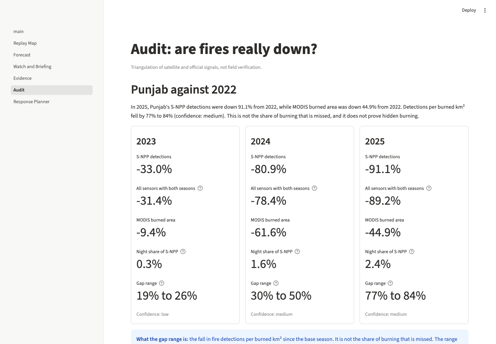
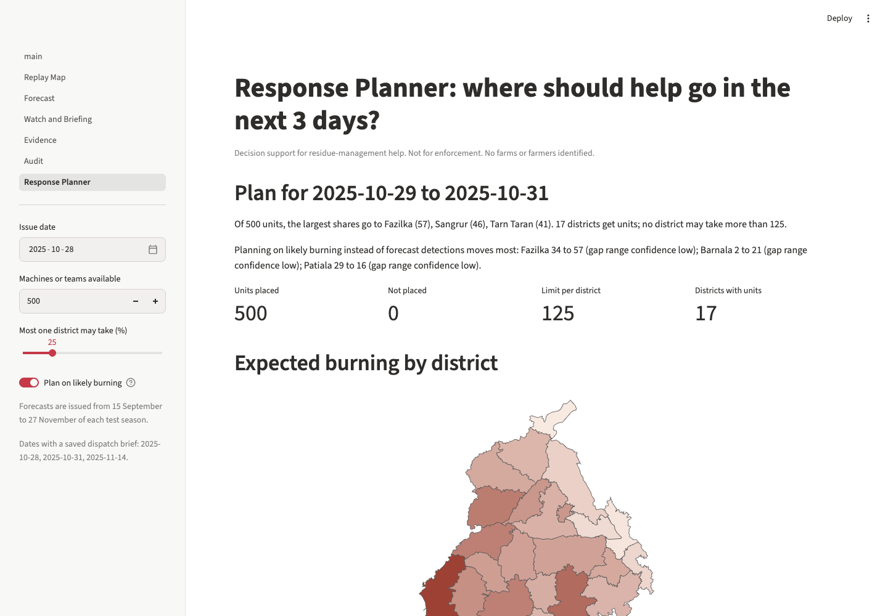
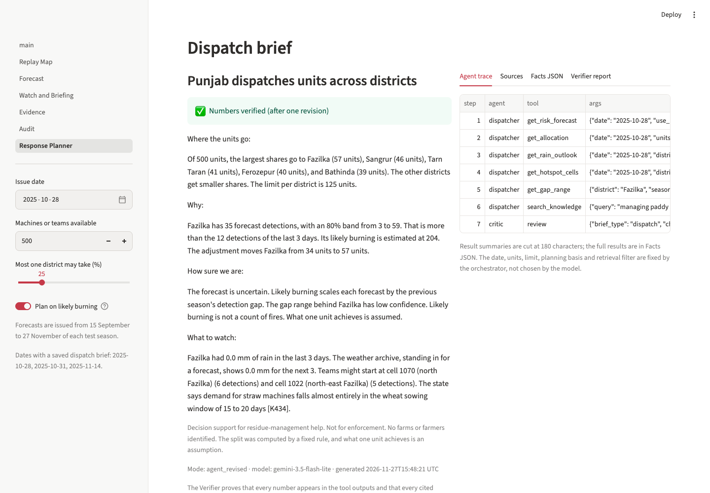
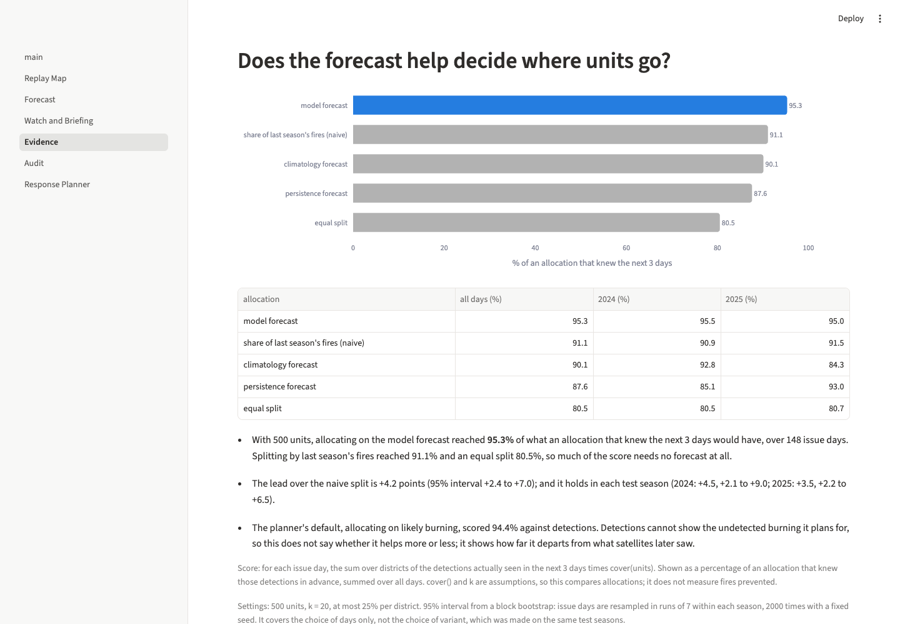
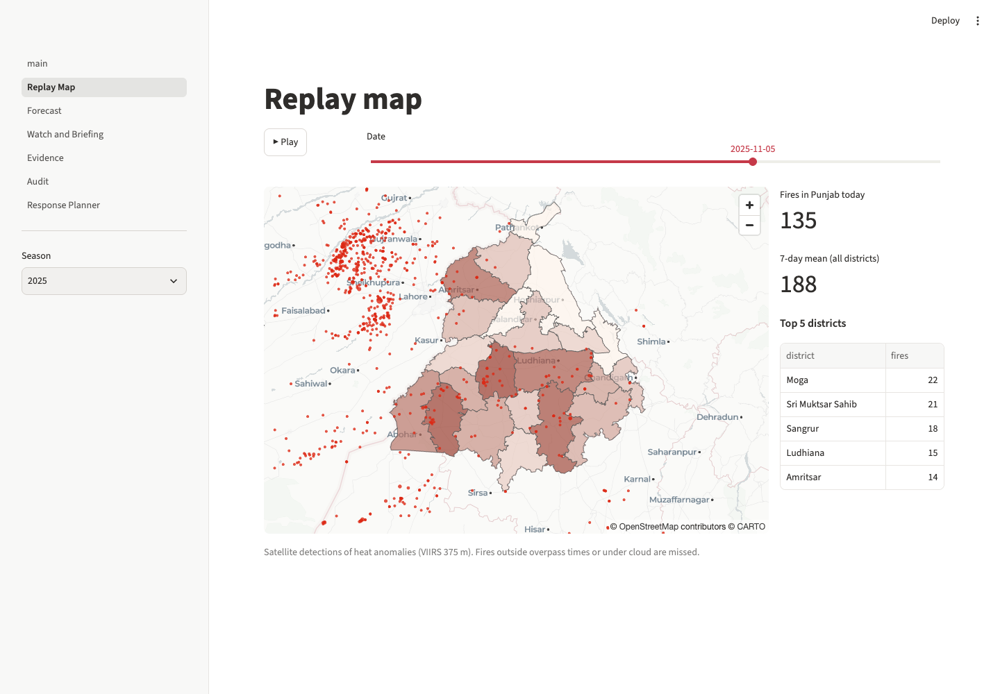
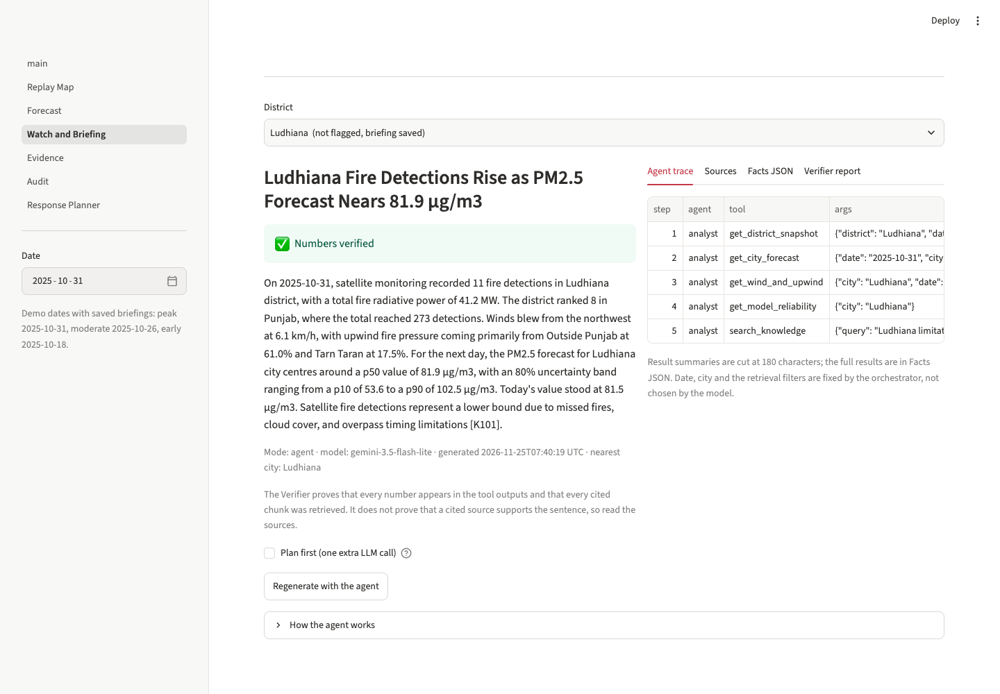

# Punjab Smoke Watch

Satellite fire counts for Punjab have fallen steeply. This project asks **how much burning has really fallen** and **where help should go in the next 3 days**, using satellite, weather and air-quality data, agents whose numbers are checked by code, and a Streamlit app that runs offline.

It is not a chatbot and has no free-text Q&A box. **The LLM never does the maths:** every number comes from a Python tool, and a Verifier that is not a language model checks it.

## The problem

Indian Punjab, 15 September to 30 November, VIIRS S-NPP detections by satellite pass:

| Season | Day detections (about 13:30) | Night detections (about 01:30) | Night share |
|---|---|---|---|
| 2022 | 45,305 | 82 | 0.2% |
| 2023 | 30,300 | 90 | 0.3% |
| 2024 | 8,530 | 142 | 1.6% |
| 2025 | 3,942 | 96 | 2.4% |

Daytime detections fell about 91%. Night detections did not fall, season-mean PM2.5 in four cities did not fall in step, and fire features did not help forecast it. Public reporting since 2024 says burning may have moved outside satellite pass times. If so, "fires down about 90%" is partly about what satellites see, and plans built on detections would miss real burning. The night counts are small, so this is **a lead to test, not proof**.

## What it does

**Module A, Audit: are fires really down?** Compares fire detections from VIIRS (S-NPP, NOAA-20, NOAA-21) and MODIS with MODIS burned area (MCD64A1) and the official counts. It reports a **detection-gap range** per district and season with a confidence level, and an Auditor agent writes a cited brief. For monitoring cells, researchers, journalists and citizens.

**Module B, Response: where should help go?** Forecasts each district's fire detections over the next 3 days, splits a fleet of machines or teams with a fixed rule, shows 5 km cells where detections clustered, and a Dispatcher agent explains the split. For agriculture officers and machinery banks. **Support, not enforcement.**

**Underneath (the first half of the project).** Ingestion with caching, district tables, a next-day PM2.5 quantile forecast with a backtest, a local RAG index with an `as_of` rule so retrieval cannot see the future, and a Sentinel, Analyst and Verifier that write district briefings.

## Architecture

```
 NASA FIRMS (VIIRS, MODIS) ─┐
 MCD64A1 burned area ───────┤
 official counts (CSV) ─────┼─> ingest (cached) ─> district tables ─┬─> AUDIT: gap ranges ──────────┐
 Open-Meteo weather, CAMS ──┘                                        ├─> 3-day fire-risk forecast <──┘ (last season's gap)
                                                                     │        └─> allocator (fixed rule) ─> 5 km cells
                                                                     └─> next-day PM2.5 forecast

 curated notes + documents the pipeline writes ─> chunks with as_of dates ─> search_knowledge

 AGENT (LLM + tools, one reusable loop)            Sentinel ─> Analyst      Auditor      Dispatcher
        │ draft
        v
 VERIFIER (rules, no LLM) ── fail ─> one revision ── fail again, or no LLM ─> fixed TEMPLATE (also verified)
        │ pass
        v
 Critic (LLM, audits and dispatches): may only delete, reorder or reword; re-verified
        v
 saved JSON in data/processed/ ─> Streamlit app
```

### The agents

| Agent | LLM? | What it does |
|---|---|---|
| Sentinel | no | Flags districts for a date (spike, high count, smog risk) |
| Analyst | yes | A district briefing from data tools and retrieval |
| Auditor | yes | An audit brief in four labelled parts, with the range, its confidence and what it leaves out |
| Dispatcher | yes | A 3-day action brief explaining an allocation it cannot change |
| Planner (optional) | yes | A short plan from flag kinds or signal names, never values |
| Critic | yes | Reads audit and dispatch drafts; never adds a number |
| Verifier | no | Checks numbers, citations, length, banned content and, per brief type, required and forbidden claims |

**What "verified" means, and what it does not.** Every number appears in a tool output or retrieved text, every citation was retrieved, and the statements each brief type must make are there. It does **not** prove that a cited source supports its sentence, or that a number is used correctly. Reading live output found briefs that passed and were still wrong (one said there were enough machines, quoting half a sentence from its source). Each such case got a new check; there will be others. Read a brief before sending it to anyone.

## Quickstart (a clean clone, no keys, no network)

```bash
git clone <this repo> && cd punjab-smoke-watch
uv sync                                   # Python 3.12 via uv
uv run streamlit run src/psw/app/main.py
```

The app reads only the committed `data/processed/`. All pages and saved briefs work without a `.env`. The run and regenerate buttons need an LLM key and show a message without one. The Replay map's background needs a network; the planner's maps have no background.

Add `--server.address localhost` to stop others on your network from opening the app and using your key.

**Saved for the demo** (listed in `data/processed/demo.json`): district briefings for 2025-10-18, 10-26 and 10-31; audits of Punjab (2024, 2025) and of Tarn Taran, Sangrur and Amritsar (2025); dispatches issued 2025-10-28, 10-31 and 11-14 for 500 units.

## Regenerating the data

Copy `.env.example` to `.env` and fill in the keys (never commit `.env`):

| Key | Used for |
|---|---|
| `FIRMS_MAP_KEY` | NASA FIRMS (free) |
| `LLM_BASE_URL`, `LLM_API_KEY`, `LLM_MODEL` | any OpenAI-compatible endpoint: the Gemini free tier, or Ollama (not tested) |

```bash
uv run python -m psw.pipeline ingest        # fetch and cache raw data (data/raw/, gitignored)
uv run python -m psw.pipeline process       # fires -> districts, daily tables
uv run python -m psw.pipeline train         # PM2.5 features, backtest, ablation
uv run python -m psw.pipeline audit-ingest  # other satellites, burned area, manual CSVs, district weather
uv run python -m psw.pipeline audit         # gap ranges, then audit briefs  (--tables-only: no LLM)
uv run python -m psw.pipeline risk-train    # 3-day fire-risk backtest, decision backtest and its intervals
uv run python -m psw.pipeline kb            # generate documents, build the index (downloads a ~130 MB model once)
uv run python -m psw.pipeline kb-eval       # retrieval eval

uv run python -m psw.pipeline brief --date 2025-10-31 [--district Sangrur]
uv run python -m psw.pipeline audit --district Sangrur --season 2025 --force     # also --plan, --no-critic
uv run python -m psw.pipeline dispatch --date 2025-10-28 --machines 500 [--district Sangrur] [--detected-only]
uv run python -m psw.pipeline demo-cache    # all saved briefs (reuses good ones; --force, --redo-dispatch)
uv run pytest -q                            # offline: a scripted fake LLM, no network
```

On macOS, LightGBM needs `brew install libomp`.

## Results

### Audit: Punjab against 2022

| Season | S-NPP detections | Burned area (MCD64A1) | Official count | Night share (2022: 0.2%) | Detection-gap range | Confidence |
|---|---|---|---|---|---|---|
| 2023 | -33.0% | -9.4% | -26.6% | 0.3% | 19% to 26% | low |
| 2024 | -80.9% | -61.6% | -78.1% | 1.6% | 30% to 50% | medium |
| 2025 | -91.1% | -44.9% | -89.8% | 2.4% | 77% to 84% | medium |

The gap is the **fall in detections per burned km²** since the base season. **It is not the share of burning that is missed.** The range shows how the result changes with the count series and base season only. It does not include the error of the burned-area product, which is unknown and is the largest uncertainty. The fall fits three explanations: burning moved outside pass times, fires became smaller or cooler, or the burned-area product's sensitivity changed. There is no field verification.

Districts are weaker: in 2025, 13 of 22 have a range (11 where counts fell more than burned area, 1 with no sign of a gap, 1 unclear) and 9 have insufficient evidence. None is above low confidence.

### Response: does the forecast help decide where units go?

500 units, 148 issue days in 2024 and 2025, scored against the detections actually seen in the next 3 days, as a share of an allocation that knew them in advance:

| Allocation | All days | 2024 | 2025 |
|---|---|---|---|
| **model forecast** | **95.3%** | 95.5% | 95.0% |
| share of last season's fires (naive) | 91.1% | 90.9% | 91.5% |
| climatology forecast | 90.1% | 92.8% | 84.3% |
| persistence forecast | 87.6% | 85.1% | 93.0% |
| equal split | 80.5% | 80.5% | 80.7% |

The lead over the naive split is +4.2 points (95% interval 2.4 to 7.0) and holds in both seasons. It is real but modest, and an equal split already reaches 80.5%. What one unit achieves is **assumed**, so this compares allocations and does not measure fires prevented. Planning on "likely burning", the default, scores 94.4% against detections, which cannot see what it plans for.

**3-day fire-risk forecast** (22 districts; ranking scored on 128 busy days):

| Variant | MAE (detections) | 80% coverage | Top-5 hit rate | Spearman |
|---|---|---|---|---|
| LightGBM model | 10.72 | 87.6% | **63.7%** | **0.73** |
| persistence (last 3 days) | **9.61** | 84.4% | 59.7% | 0.66 |
| climatology | 13.34 | 81.3% | 57.1% | 0.63 |

Picking 5 districts blindly would score about 23%. The model is **not** the most accurate, and its ranking lead over persistence is **unproven**: +7.9 points in 2024, -0.3 in 2025. Rain over the next 3 days is taken from the weather archive, which is optimistic.

### Next-day PM2.5 forecast

616 out-of-sample forecasts per variant (4 cities × 154 days):

| Variant | MAE (µg/m³) | Pinball loss | 80% band coverage | Band width (µg/m³) |
|---|---|---|---|---|
| full (with fire features) | 11.94 | 4.05 | 84.4% | 41.6 |
| no fire features | 11.88 | 3.97 | 83.8% | 40.5 |
| persistence (tomorrow = today) | **11.20** | **3.83** | 76.9% | **33.9** |

**The fire features did not help, and persistence is best on MAE and pinball.** We did not tune on the test seasons.

### Retrieval and agents

**Retrieval**, 23 queries written by us (a sanity check, not a benchmark): hit@3 hybrid 23, embeddings 22, BM25 20; hit@1 20, 21, 17; MRR 0.93, 0.93, 0.80.

**Saved briefs** (all pass the Verifier):

| Set | Saved | Agent | After one revision | Template | Critic warnings | Edited by hand |
|---|---|---|---|---|---|---|
| district briefings (demo set) | 9 | 8 | 1 | 0 | not run | 0 |
| district briefings (random sample, seed 42) | 12 | 12 | 0 | 0 | not run | 0 |
| audit briefs | 7 | 2 | 5 | 0 | 3 | 1 |
| dispatch briefs | 3 | 2 | 1 | 0 | 0 | 0 |

These are the outputs **after reruns and after fixes to the checks**, not the chance that a new run passes.

## Ethics

- **Support, not enforcement.** The Response module is for placing help. Dispatch briefs may not mention penalties, police reports or enforcement.
- **No one is identified.** The smallest unit it reports is a 5 km grid cell, its maps have no place names, and dispatch briefs that name a village or person are rejected (a name that is also an ordinary word could slip through). The separate Replay map plots raw satellite detections over a labelled background map.
- **Cells with one detection are never offered** as places to send a team.
- **Machine counts are context only.** They are machines supplied on subsidy, not machines that work, and never enter the allocation.
- **Claims about official numbers** should go no further than the signals support. The auditor is told not to say farmers are hiding fires or that official figures are wrong, and the Critic is asked to flag it. **No code check enforces this**, so read audit briefs.

## Screenshots

Taken from a clean copy of the repo with no `.env` and no keys.

| Audit | Response Planner |
|---|---|
|  |  |
| **Dispatch brief** | **Evidence: decision backtest** |
|  |  |
| **Replay map** | **District briefing** |
|  |  |

More in [`docs/screenshots/`](docs/screenshots/).

## Data sources and credits

- **Fire detections:** NASA FIRMS: VIIRS 375 m (S-NPP, NOAA-20, NOAA-21) and MODIS (Terra, Aqua). https://firms.modaps.eosdis.nasa.gov
- **Burned area:** NASA MODIS MCD64A1 Collection 6.1, downloaded from the University of Maryland server named in its user guide.
- **Official fire counts:** Punjab's reports to the National Green Tribunal (satellite-based), with the link on every row of `data/manual/official_counts.csv`.
- **Machine figures:** a state status report of 26 Nov 2024; link in `data/manual/crm_machines.csv`.
- **PM2.5:** Copernicus Atmosphere Monitoring Service (CAMS) via the Open-Meteo air-quality API (data by [Open-Meteo.com](https://open-meteo.com/), [CC BY 4.0](https://creativecommons.org/licenses/by/4.0/)). Modelled, not a ground monitor.
- **Weather:** [Open-Meteo.com](https://open-meteo.com/) (ERA5 reanalysis, Copernicus Climate Change Service), [CC BY 4.0](https://creativecommons.org/licenses/by/4.0/).
- **District boundaries:** geoBoundaries IND ADM2 (gbOpen), ODbL 1.0, attribution to geoBoundaries (wmgeolab). https://www.geoboundaries.org
- **Embeddings:** `BAAI/bge-small-en-v1.5`, run locally with fastembed.
- **PM2.5 reference line:** India's National Ambient Air Quality Standards, 24-hour value of 60 µg/m³.
- **Libraries:** pandas, GeoPandas, rasterio, paramiko, LightGBM, scikit-learn, rank-bm25, Streamlit, pydeck, Plotly, the OpenAI Python SDK (as a generic client).

## Limitations

- Satellites detect **heat anomalies**, not "stubble burning" specifically, and miss fires under cloud and outside pass times.
- The audit is **triangulation, not ground truth**. The burned-area product is 500 m, misses small fields and is low confidence in cropland.
- "Likely burning" scales a forecast by last season's gap. It is not a count of fires, cannot be checked against satellite data, and can move many units on a low-confidence range.
- What one machine or team achieves is assumed.
- 5 km cells come from detections, so they cannot show where undetected burning is.
- Four seasons (2022 to 2025) is a short record. Test seasons were also used to pick the fire-risk variant.
- PM2.5 is modelled and covers four cities. FIRMS dates are UTC, treated as the local day.
- 22 districts: **Malerkotla** is counted inside Sangrur.
- A student project, not a regulatory or health tool.

## What is ours

The detection-gap method with its signal roles, the fire-risk features and decision backtest, the allocator, the 5 km hotspot rule, the upwind fire-pressure feature, the RAG corpus built from the pipeline's own outputs with the `as_of` rule, the agent loop, and the Verifier. Open data and libraries are credited above.

## More

`AGENTS.md` (context for AI sessions and the decisions log), `docs/PLAN.md` (the build plan), `docs/PROGRESS.md` (what was done, deviations, open items), `docs/feasibility.md` (data availability), `docs/REPORT_DATA.md` (facts for the report and slides), `Punjab_Smoke_Watch.md` (the original brief and the demo script).
